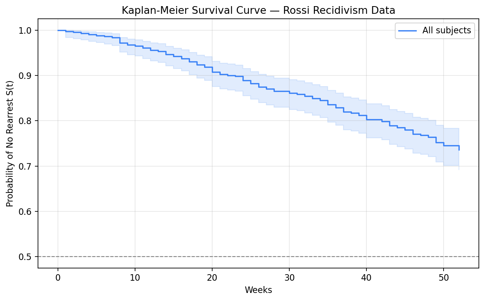

[Statistics](../README.md) › [存活分析](README.md) › Kaplan-Meier

# Kaplan-Meier 估計量 (Kaplan-Meier Estimator)

從觀察資料估計存活函數 S(t) = P(T > t) 的標準**無母數**方法，正確處理設限、不假設任何分配。幾乎每份存活分析報告都從 KM 曲線開始，就像連續資料先畫直方圖：**建模前先畫 KM**。

KM 估計的是「到 t 為止事件**尚未**發生的機率」，不是平均存活時間，也不是 hazard。

## 公式

$$
\hat S(t) = \prod_{t_i \le t} \left(1 - \frac{d_i}{n_i}\right)
$$

| 符號 | 意義 |
| --- | --- |
| tᵢ | **有事件發生**的相異時間點 |
| dᵢ | tᵢ 的事件數 |
| nᵢ | tᵢ 前一刻仍在追蹤中的人數（**風險集 risk set**） |
| 1 − dᵢ/nᵢ | **條件存活**：已活到 tᵢ 的人撐過 tᵢ 的機率 |
| Ŝ(t) | **累積存活**：把各區間的條件存活率連乘 |

**為什麼是階梯函數？**

- 事件發生 → 曲線往下跳一階
- 設限發生 → **不往下跳**，但之後的風險集變小（設限標記 + 顯示此人的資訊到此為止）

這正是 KM 處理設限的方式：設限者在設限前貢獻資訊，之後從風險集移除。

## 手算範例

| 時間 | 事件 δ |
| --- | --- |
| 3, 5, 5, 8, 10, 12, 12, 15 | 1, 0, 1, 1, 0, 1, 1, 0 |

| tᵢ | nᵢ | dᵢ | 1 − d/n | Ŝ(t) |
| --- | --- | --- | --- | --- |
| 3 | 8 | 1 | 0.875 | 0.875 |
| 5 | 7 | 1 | 0.857 | 0.750 |
| 8 | 5 | 1 | 0.800 | 0.600 |
| 12 | 3 | 2 | 0.333 | 0.200 |

t = 5 有一個事件與一個設限同時發生：慣例上設限視為發生在事件**之後**，所以 n = 7。t = 8 的風險集為 5，因為 t = 5 的設限者已移除。

```python
import pandas as pd

d = pd.DataFrame({"time": [3, 5, 5, 8, 10, 12, 12, 15], "event": [1, 0, 1, 1, 0, 1, 1, 0]})
S, rows = 1.0, []
for t in sorted(d.loc[d.event == 1, "time"].unique()):
    n = (d.time >= t).sum()                          # 風險集
    k = ((d.time == t) & (d.event == 1)).sum()       # 事件數
    S *= 1 - k / n
    rows.append((t, n, k, round(S, 3)))
pd.DataFrame(rows, columns=["t", "n_at_risk", "d", "S"])
```

## lifelines 範例

```python
import matplotlib.pyplot as plt
from lifelines import KaplanMeierFitter
from lifelines.datasets import load_rossi
from lifelines.plotting import add_at_risk_counts
from lifelines.utils import restricted_mean_survival_time

rossi = load_rossi()                       # 出獄後再被捕的時間（週）
T, E = rossi["week"], rossi["arrest"]

kmf = KaplanMeierFitter().fit(T, E, label="All")
kmf.median_survival_time_                  # 中位存活時間
kmf.survival_function_at_times([10, 26, 52])
kmf.confidence_interval_                   # Greenwood 公式 + log 轉換的 95% CI

# 單組曲線 + 風險表
ax = kmf.plot_survival_function(ci_show=True)
add_at_risk_counts(kmf, ax=ax)
plt.show()

# 分組比較
fig, ax = plt.subplots()
fits = {}
for g, label in [(1, "Received Aid"), (0, "No Aid")]:
    m = rossi["fin"] == g
    fits[label] = KaplanMeierFitter().fit(T[m], E[m], label=label)
    fits[label].plot_survival_function(ax=ax)
add_at_risk_counts(*fits.values(), ax=ax)
plt.show()

# RMST（到 52 週）
{k: restricted_mean_survival_time(v, t=52) for k, v in fits.items()}
```



R 版本：

```r
library(survival); library(survminer)
fit <- survfit(Surv(time, status) ~ sex, data = lung)
ggsurvplot(fit, data = lung, pval = TRUE, conf.int = TRUE, risk.table = TRUE, surv.median.line = "hv")
```

## 讀 KM 曲線

1. 早期下降多陡？
2. 中位存活時間在哪（若存在）？
3. 尾端還剩多少人在風險集？
4. 組間差異是一直存在，還是只在早期 / 晚期？

> **尾端很脆弱**：追蹤後期風險集很小，每個事件影響很大、CI 很寬，曲線右側看起來戲劇化但統計上不穩定。**一定要附風險表 (at-risk table)**。

**信賴區間**：lifelines 預設用 Greenwood 公式（並在 log 尺度計算，確保 CI 在 [0, 1] 內）：

$$
\widehat{\text{Var}}[\hat S(t)] = \hat S(t)^2 \sum_{t_i \le t} \frac{d_i}{n_i(n_i - d_i)}
$$

## 中位數無法估計時：RMST

曲線在觀察期間從未降到 0.5 以下時，中位存活時間**未定義**。這**不代表**存活無限長，只代表觀察期內不到一半的人發生事件。此時報告：

- **RMST(τ)** = KM 曲線下到 τ 的面積 = 到 τ 為止的平均無事件時間；永遠有定義、可直接比較組間差異（「平均多 x 週無事件」）
- 或固定時點存活率（1 年、5 年）

曲線**交叉**時 hazard ratio 不固定、意義不清，RMST 差異是更好的比較指標，見 [Log-rank 檢定](log-rank-test.md)。

## 常見解讀錯誤

| 錯誤 | 為什麼錯 |
| --- | --- |
| 把設限讀成事件 | 設限是追蹤結束，不是事件發生 |
| 過度解讀尾端 | 風險集太小，估計不穩 |
| 看到曲線分開就當作有差異 | 需要正式檢定（[log-rank](log-rank-test.md)） |
| 只報中位數 | 漏掉不確定性與 RMST 等其他摘要 |
| 用 1 − KM 當作有競爭風險時的累積發生率 | 會高估，見 [競爭風險](core-concepts.md#競爭風險-competing-risks) |
