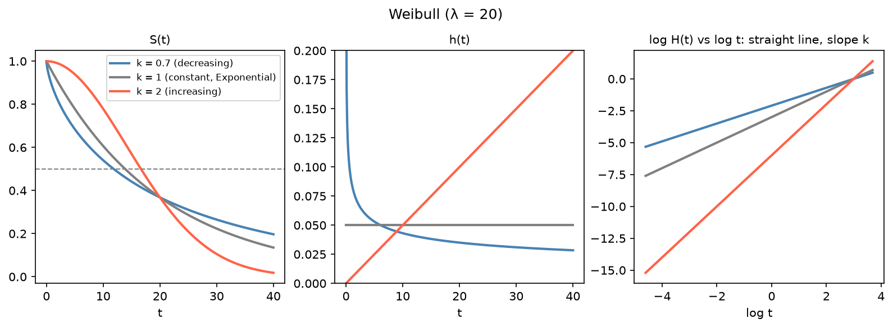

[Statistics](../README.md) › [存活分析](README.md) › 存活與風險函數

# 存活函數與風險函數 (Survival & Hazard Functions)

三個函數是同一件事的三種視角，知道任一個就能推出其他兩個。KM 估計 S(t)、Cox 模型建模 h(t)、Nelson-Aalen 估計 H(t)。

## 三個函數

| 函數 | 定義 | 範圍 | 回答 |
| --- | --- | --- | --- |
| **存活函數** S(t) (survival function) | $P(T > t)$ | 1 → 0，單調不增 | 到時間 t 還有多少比例**未發生**事件？ |
| **風險函數** h(t) (hazard function) | $\lim_{\Delta t \to 0} \frac{P(t \le T < t+\Delta t \mid T \ge t)}{\Delta t}$ | ≥ 0，**可以 > 1** | **已活到 t 的人**，此刻發生事件的瞬間速率？ |
| **累積風險** H(t) (cumulative hazard) | $\int_0^t h(u)\,du$ | 0 → ∞，單調不減，**不受 1 限制** | 到 t 為止累積的風險 |

> **風險 ≠ 機率**。h(t) 是**速率**（單位 1/時間）。很多解讀錯誤來自把 hazard 當成機率。

為什麼用 H(t)？h(t) 直接從資料估計很雜亂；H(t) 較平滑、容易估計（Nelson-Aalen），而且指數分配下 H(t) 是直線，可做圖形檢查。

## 函數間的關係

| 從 → 到 | 公式 |
| --- | --- |
| S → H | $H(t) = -\ln S(t)$ |
| H → S | $S(t) = e^{-H(t)}$ |
| S → h | $h(t) = -\frac{d}{dt}\ln S(t) = f(t)/S(t)$ |
| h → H | $H(t) = \int_0^t h(u)\,du$ |

```python
import numpy as np
import pandas as pd
from scipy.stats import weibull_min

dist = weibull_min(c=1.8, scale=20)
t = np.array([5, 10, 15, 20, 25, 30])
S = dist.sf(t)                       # S(t) = 1 − CDF
H = -np.log(S)                       # H(t) = −ln S(t)
h = dist.pdf(t) / S                  # h(t) = f(t) / S(t)
pd.DataFrame({"t": t, "S": S.round(3), "H": H.round(3), "h": h.round(4)})
# t = 20（= scale）時 S = e^{-1} ≈ 0.368、H = 1
```

## 風險的形狀

| 型態 | 說明 | 例子 | 對應分配 |
| --- | --- | --- | --- |
| 固定 (constant) | 風險不隨時間改變（無記憶性） | 放射性衰變、部分電子故障 | Exponential；Weibull k = 1 |
| 遞增 (increasing) | 風險隨時間增加 | 老化死亡、機械磨損 | Weibull k > 1、Gompertz |
| 遞減 (decreasing) | 風險隨時間下降 | 術後恢復期、嬰兒死亡率 | Weibull k < 1 |
| 浴缸形 (bathtub) | 早期高、中期低、晚期高 | 機器壽命（初期故障 + 磨損） | 混合 / 分段模型 |
| 單峰 (hump-shaped) | 先升後降 | 診斷後癌症死亡率 | Log-normal、Log-logistic |

Weibull：$S(t) = e^{-(t/\lambda)^k}$、$h(t) = \frac{k}{\lambda}(t/\lambda)^{k-1}$、$H(t) = (t/\lambda)^k$。log H(t) 對 log t 為直線（斜率 k），可用來檢查 Weibull 是否合適。各分配的比較與配適見 [參數模型](parametric-models.md)。



三條 S(t) 都在 t = λ = 20 交於 e⁻¹ ≈ 0.368：λ 決定時間尺度，k 決定風險隨時間的形狀。

## 摘要統計量

| 統計量 | 定義 | 解讀 | 用途 |
| --- | --- | --- | --- |
| **中位存活時間** (median survival) | $\hat S(t) = 0.5$ 的 t | 一半的人發生事件的時間 | 最常用；不需要完整追蹤 |
| 平均存活時間 | $\int_0^\infty S(t)\,dt$ | 期望無事件時間 | 追蹤不完整時通常**無法估計** |
| **RMST(τ)** 限制平均存活時間 (restricted mean survival time) | $\int_0^\tau S(t)\,dt$ | 到 τ 為止的平均存活時間 | 中位數無法估計或**曲線交叉**時 |
| 固定時點存活率 | $\hat S(t^*)$ | 存活超過 t* 的機率 | 1 年、3 年、5 年存活率 |

> 中位存活與 RMST 描述**絕對**存活經驗；Cox 的 hazard ratio 描述**相對**風險。兩者都報告較完整，見 [結果解讀](interpretation.md)。
