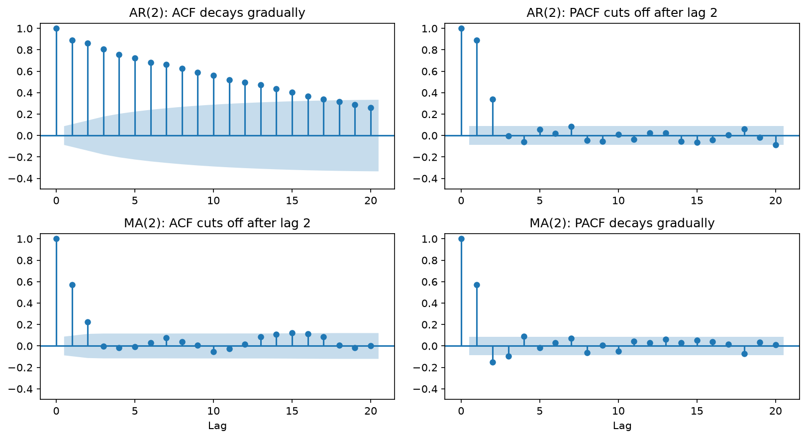

[Statistics](../README.md) › [時間序列](README.md) › 自相關

# 自相關：ACF 與 PACF (Autocorrelation)

衡量序列與**自己的過去**有多相關。ACF / PACF 圖是定態序列的「指紋」，也是選擇 ARIMA 階數 p、q 的核心工具。金融情境（動能、均值回歸）的解讀見 [Finance: Autocorrelation](../../applied-domains/finance/autocorrelation.md)。

| | ACF 自相關函數 (autocorrelation function) | PACF 偏自相關函數 (partial ACF) |
| --- | --- | --- |
| 衡量 | yₜ 與 yₜ₋ₖ 的**總**相關（含經由中間期的間接效果） | 移除 yₜ₋₁…yₜ₋ₖ₊₁ 的影響後，yₜ 與 yₜ₋ₖ 的**直接**相關 |
| 類比 | 一般相關係數 | 迴歸中的偏相關 |
| 公式 | $\rho_k = \text{Cov}(Y_t, Y_{t-k}) / \text{Var}(Y_t)$ | — |
| 用來決定 | MA 階數 **q** | AR 階數 **p** |

## 型態辨識表

| 過程 | ACF | PACF |
| --- | --- | --- |
| **AR(p)** | 指數衰減（或震盪衰減） | **lag p 後截斷** |
| **MA(q)** | **lag q 後截斷** | 指數衰減 |
| ARMA(p, q) | 衰減 | 衰減 → 用 AIC 選 |
| 白噪音 | 全在信賴帶內 | 全在信賴帶內 |
| 非定態 | **非常緩慢地衰減**（接近 1） | lag 1 有大尖峰 |
| 季節性未移除 | lag m（如 12）仍很大 | — |

> **口訣**：AR 看 PACF 截斷、MA 看 ACF 截斷。
>
> 藍色區域是 95% 信賴帶，超出者在 α = 0.05 下顯著。36 個 lag 中有一兩個稍微超出是正常的（多重比較）。

```python
import numpy as np
import pandas as pd
import matplotlib.pyplot as plt
from statsmodels.graphics.tsaplots import plot_acf, plot_pacf
from statsmodels.tsa.arima_process import ArmaProcess

url = "https://raw.githubusercontent.com/jbrownlee/Datasets/master/airline-passengers.csv"
y = pd.read_csv(url, parse_dates=["Month"], index_col="Month").asfreq("MS")["Passengers"]
series = np.log(y).diff().dropna()          # 先轉成定態

fig, ax = plt.subplots(2, 1, figsize=(10, 7))
plot_acf(series, lags=36, ax=ax[0])
plot_pacf(series, lags=36, ax=ax[1], method="ywm")
plt.tight_layout(); plt.show()

# 練習：模擬已知過程，驗證型態（注意 ArmaProcess 的 AR 係數要取負號）
ar2 = ArmaProcess(ar=[1, -0.6, -0.3], ma=[1]).generate_sample(300)    # AR(2)：PACF 在 lag 2 截斷
ma2 = ArmaProcess(ar=[1], ma=[1, 0.7, 0.4]).generate_sample(300)      # MA(2)：ACF 在 lag 2 截斷
```



## 用 ACF 檢查定態

原始 log 序列的 ACF 緩慢衰減、長時間接近 1 → 非定態；差分後應快速下降。若仍緩慢衰減，再差分一次。見 [定態](stationarity.md)。

## Ljung-Box 檢定：殘差還有自相關嗎？

配適模型後，檢查**殘差**是否為白噪音。

- H₀：殘差是白噪音（無自相關）
- p > 0.05 → ✅ 模型已抓到結構；p < 0.05 → ❌ 還有結構沒建模

```python
from statsmodels.stats.diagnostic import acorr_ljungbox
acorr_ljungbox(model_result.resid, lags=[10, 20], return_df=True)
```

> ACF 描述結構，不說明原因。趨勢殘留、季節性、差分不足、真正的序列持續性都可能產生相似的 ACF。
>
> 迴歸殘差有自相關時（Durbin-Watson ≠ 2），一般 OLS 的 SE 會失準，見 [假設檢查](../inferential-statistics/assumption-checks.md#獨立性-independence)。
