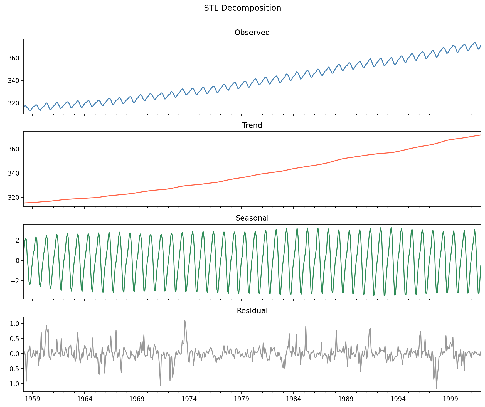

[Statistics](../README.md) › [時間序列](README.md) › 分解

# 時間序列分解 (Decomposition)

把序列拆成**趨勢、季節、殘差**，看出模型還需要處理哪些結構，也更容易發現異常或結構改變。分解是描述性的，不保證能產生好的預測。

## 加法 vs 乘法

| 模型 | 公式 | 何時用 |
| --- | --- | --- |
| 加法 (additive) | Yₜ = Tₜ + Sₜ + Rₜ | 季節振幅**固定** |
| 乘法 (multiplicative) | Yₜ = Tₜ × Sₜ × Rₜ | 季節振幅隨水準**等比例變大**（喇叭形） |

取 log 可把乘法轉成加法：log Y = log T + log S + log R，所以常先 log 再做加法分解。

## Classical vs STL

| | Classical（移動平均） | **STL**（Seasonal-Trend decomposition using LOESS） |
| --- | --- | --- |
| 端點的趨勢 | 缺失（前後 m/2 期為 NaN） | 有 |
| 季節型態 | 固定不變 | 可隨時間演變 |
| 對離群值 | 敏感 | `robust=True` 可降低影響 |
| 多重季節性 | 不行 | 不行（用 **MSTL**） |
| 乘法 | 直接支援 | 先取 log |
| 建議 | 快速探索、教學 | **實務預設** |

```python
import numpy as np
import statsmodels.api as sm
from statsmodels.tsa.seasonal import seasonal_decompose, STL

series = sm.datasets.co2.load_pandas().data["co2"].resample("MS").mean().interpolate()

classical = seasonal_decompose(series, model="additive", period=12)
classical.plot()

res = STL(series, period=12, robust=True).fit()
res.plot()                                  # observed / trend / seasonal / resid

# 去季節化序列（官方「季節調整後失業率」就是這個）
seasonally_adjusted = series - res.seasonal
```



| STL 參數 | 說明 |
| --- | --- |
| `period` | 季節週期（月資料 12、日資料 7），必填 |
| `robust` | 有離群值時設 `True` |
| `seasonal` | 季節成分平滑度（奇數，越大越平滑） |
| `trend` | 趨勢平滑度（奇數，需 > period） |

## 成分強度 (Wang, Smith & Hyndman, 2006)

$$
F_T = \max\left(0,\ 1 - \frac{\text{Var}(R)}{\text{Var}(T + R)}\right), \qquad
F_S = \max\left(0,\ 1 - \frac{\text{Var}(R)}{\text{Var}(S + R)}\right)
$$

範圍 0–1；> 0.6 表示該成分顯著，需要在模型中處理。

```python
var_r = np.var(res.resid)
strength_trend = max(0, 1 - var_r / np.var(res.trend + res.resid))
strength_seasonal = max(0, 1 - var_r / np.var(res.seasonal + res.resid))
```

## 分解之後

| 觀察 | 下一步 |
| --- | --- |
| 強趨勢、弱季節 | 差分或趨勢模型 |
| 強季節 | 季節差分、[SARIMA](seasonality-sarima.md)、STL + ARIMA |
| 殘差有大尖峰 | 調查異常或介入事件 |
| 殘差仍有自相關 | 進入 [ARIMA](arima.md) 建模 |

殘差應接近**白噪音 (white noise)**：平均 ≈ 0、無自相關、大致常態。檢查方式見 [自相關](autocorrelation.md) 與 [預測評估](forecast-evaluation.md#殘差診斷)。
