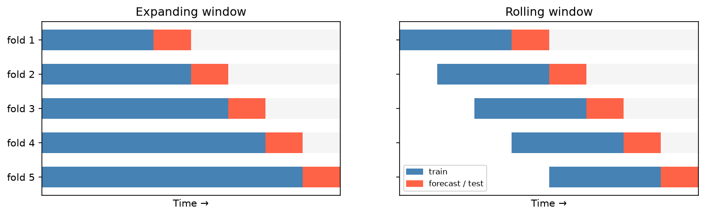

[Statistics](../README.md) › [時間序列](README.md) › 預測評估

# 預測評估 (Forecast Evaluation)

在訓練資料上配適得好，不代表能預測未來。**永遠不要用訓練資料評估預測表現**，而且時間序列必須**依時間順序切分**：用過去預測未來，不能隨機抽樣。

> 這與一般 ML 的隨機 K-fold 不同；隨機切分會造成「用未來預測過去」的 [資料洩漏](../../machine-learning/foundations/data-leakage.md)。

## 依時間切分

測試集至少保留一到兩個完整季節週期（月資料約 12–24 個月）。

```python
import numpy as np
import pandas as pd
from statsmodels.tsa.statespace.sarimax import SARIMAX

url = "https://raw.githubusercontent.com/jbrownlee/Datasets/master/airline-passengers.csv"
y = pd.read_csv(url, parse_dates=["Month"], index_col="Month").asfreq("MS")["Passengers"]
train, test = y.iloc[:-24], y.iloc[-24:]

res = SARIMAX(np.log(train), order=(1, 1, 1), seasonal_order=(1, 1, 1, 12)).fit(disp=False)
y_pred = np.exp(res.forecast(len(test))).to_numpy()
y_true = test.to_numpy()
```

## 誤差指標

| 指標 | 公式 | 特性 | 適用 |
| --- | --- | --- | --- |
| **MAE** | $\frac{1}{h}\sum \lvert y_t - \hat{y}_t \rvert$ | 原始單位、直觀 | 一般報告 |
| **RMSE** | $\sqrt{\frac{1}{h}\sum (y_t - \hat{y}_t)^2}$ | 重罰大誤差 | 大失誤代價高 |
| **MAPE** | $\frac{100\%}{h}\sum \left\lvert \frac{y_t - \hat{y}_t}{y_t} \right\rvert$ | 百分比、好溝通 | 對非技術人員；**y = 0 時無定義**、值小時偏誤大 |
| **MASE** | MAE ÷ 訓練期季節 naive 的 MAE | 無尺度；< 1 表示贏過 naive | **跨序列比較**、確認模型有加值 |
| AIC / BIC | — | 樣本內、懲罰複雜度 | 選階（不是評估預測） |

> 不要用 R² 評估時間序列預測：它描述樣本內配適，在非定態序列上可能嚴重誤導。MAE / RMSE 的一般說明見 [ML: MSE / RMSE](../../machine-learning/evaluation/mse-rmse.md)。

```python
mae  = np.mean(np.abs(y_true - y_pred))
rmse = np.sqrt(np.mean((y_true - y_pred) ** 2))
mape = np.mean(np.abs((y_true - y_pred) / y_true)) * 100

m = 12
x = train.to_numpy()
naive_mae = np.mean(np.abs(x[m:] - x[:-m]))      # 訓練期季節 naive（ŷₜ = yₜ₋ₘ）的 MAE
mase = mae / naive_mae                           # < 1 → 贏過季節 naive
```

## 一定要比較基準模型 (Baselines)

| 基準 | 定義 | 何時難以打敗 |
| --- | --- | --- |
| Naive（隨機漫步） | ŷₜ₊₁ = yₜ | 許多金融序列 |
| 季節 naive | ŷₜ = yₜ₋ₘ（去年同期） | 季節性強的序列 |
| 平均 | ŷ = 訓練期平均 | 無趨勢、無季節 |
| Drift | 沿訓練期平均斜率外推 | 穩定的強趨勢 |

```python
seasonal_naive = np.tile(train.to_numpy()[-12:], 2)   # 最後 12 個月重複，覆蓋 24 期測試集
np.mean(np.abs((y_true - seasonal_naive) / y_true)) * 100   # 基準 MAPE
```

打不過 naive（MASE > 1）代表模型沒有加值。見 [ML: Baselines](../../machine-learning/evaluation/baselines-and-error-analysis.md)。

## 時間序列交叉驗證 (Walk-Forward Validation)

單一切分對「剛好保留哪段」很敏感。**滾動起點 (rolling origin)** 在多個時間點重複「訓練 → 預測」：

| 視窗 | 做法 | 何時用 |
| --- | --- | --- |
| 擴張視窗 (expanding) | 訓練集逐步變大 | 預設，使用所有歷史 |
| 滾動視窗 (rolling) | 訓練集大小固定 | 懷疑過程隨時間改變 |



```python
log_y, horizon, mapes = np.log(y), 12, []
for origin in range(84, len(y) - horizon + 1, 6):           # 從第 7 年開始，每 6 個月一個起點
    r = SARIMAX(log_y.iloc[:origin], order=(1, 1, 1), seasonal_order=(1, 1, 1, 12)).fit(disp=False)
    f = np.exp(r.forecast(horizon)).to_numpy()
    a = y.iloc[origin:origin + horizon].to_numpy()
    mapes.append(np.mean(np.abs((a - f) / a)) * 100)
np.mean(mapes), np.std(mapes)

# sklearn 版切分器：from sklearn.model_selection import TimeSeriesSplit
```

## 殘差診斷

| 檢查 | 方法 | 合格 |
| --- | --- | --- |
| 無趨勢 / 型態 | 殘差 vs 時間 | 隨機分布在 0 附近 |
| 變異固定 | 殘差 vs 時間 | 無擴散或聚集 |
| 近似常態 | 直方圖、Q–Q 圖 | 鐘形、貼近對角線（影響預測區間） |
| 無自相關 | 殘差 ACF | 全在信賴帶內 |
| Ljung-Box | `acorr_ljungbox(resid, lags=[12, 24])` | p > 0.05 |

```python
res.plot_diagnostics(figsize=(12, 8))    # 一次畫出上述四張圖
```

殘差有型態 = 有結構沒被利用 = 模型還能改進。

> 預測評估有兩件事：**準確度**（多接近實際值）與**決策有用性**（夠不夠支持要做的決定）。RMSE 不錯的模型，若總在最關鍵的時間點失準，仍然不可接受。
