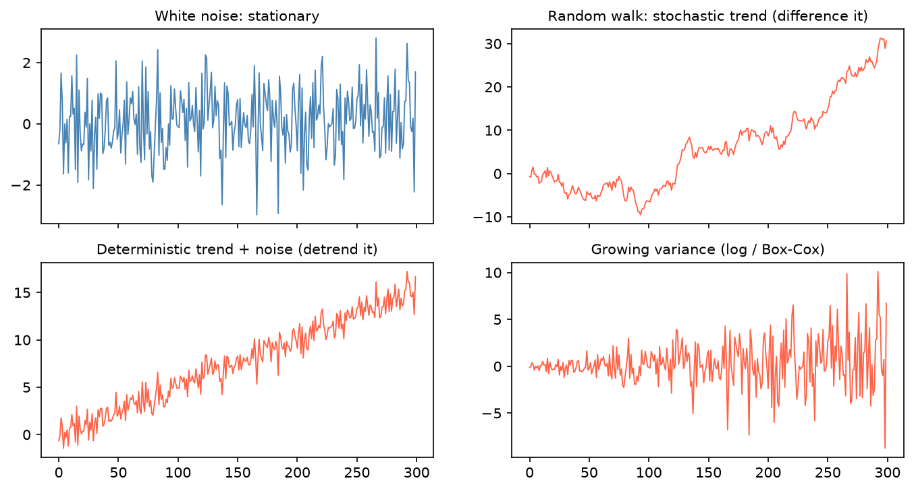

[Statistics](../README.md) › [時間序列](README.md) › 定態

# 定態 (Stationarity)

ARIMA、VAR 等多數古典模型都假設序列是定態的。非定態序列的統計性質隨時間改變，過去的規律無法用來預測未來。

> **偽迴歸 (spurious regression)**：兩個無關的非定態序列（例如都有上升趨勢）做迴歸，也可能得到很高的 R² 與顯著 p 值。

## 定義：弱定態 (weak / covariance stationarity)

| 條件 | 意義 |
| --- | --- |
| 平均固定 | E[Yₜ] = μ |
| 變異固定 | Var(Yₜ) = σ² |
| 自共變異只依落後期數 | Cov(Yₜ, Yₜ₋ₖ) 只與 k 有關，與 t 無關 |

直覺：不論從哪個時間點看，序列都「長得一樣」：沒有趨勢、沒有變異改變、沒有季節性。

| 序列 | 定態？ |
| --- | --- |
| 白噪音 (white noise) | ✅ |
| 隨機漫步 (random walk) $y_t = y_{t-1} + \varepsilon_t$ | ❌ 隨機趨勢，差分後定態 |
| 確定性趨勢 + 雜訊 | ❌ 去趨勢後定態 |
| 變異隨時間變大 | ❌ log / Box-Cox |



## 檢定：ADF + KPSS 一起用

| 檢定 | H₀ | H₁ |
| --- | --- | --- |
| **ADF** (Augmented Dickey-Fuller) | 有單根 (unit root)，**非定態** | 定態 |
| **KPSS** | **定態** | 非定態 |

兩者虛無假設相反，搭配使用較可靠（ADF 檢定力偏低，常無法拒絕單根）。

| ADF | KPSS | 結論 |
| --- | --- | --- |
| 拒絕 H₀ | 不拒絕 H₀ | ✅ 定態 |
| 不拒絕 | 拒絕 | ❌ 非定態（單根）→ 差分 |
| 拒絕 | 拒絕 | ⚠️ 趨勢定態 (trend-stationary) → 去趨勢後再測 |
| 不拒絕 | 不拒絕 | ⚠️ 無法判斷 → 看圖 |

```python
import numpy as np
import pandas as pd
from statsmodels.tsa.stattools import adfuller, kpss

url = "https://raw.githubusercontent.com/jbrownlee/Datasets/master/airline-passengers.csv"
y = pd.read_csv(url, parse_dates=["Month"], index_col="Month").asfreq("MS")["Passengers"]

def stationarity_report(s):
    s = s.dropna()
    adf_p = adfuller(s, autolag="AIC")[1]
    kpss_p = kpss(s, regression="c", nlags="auto")[1]
    return {"ADF p": round(adf_p, 4), "KPSS p": round(kpss_p, 4)}

stationarity_report(y)                    # 原始序列：非定態
stationarity_report(np.log(y).diff())     # log + 一階差分
```

## 轉換成定態

| 問題 | 轉換 | 備註 |
| --- | --- | --- |
| 隨機趨勢 | 一階差分 Δyₜ = yₜ − yₜ₋₁ | d = 1 能處理多數情況 |
| 仍非定態 | 二階差分 | 很少需要 |
| 季節性 | 季節差分 yₜ − yₜ₋ₘ | 見 [SARIMA](seasonality-sarima.md) |
| 變異隨水準增加 | log | 乘法結構 |
| 不確定用哪個冪次 | Box-Cox（λ = 1 不轉換、0.5 開根號、0 log、−1 倒數） | `scipy.stats.boxcox` |

```python
from scipy.stats import boxcox
from pmdarima.arima import ndiffs

_, lam = boxcox(y)                         # λ ≈ 0 → log 最適合
ndiffs(np.log(y), test="adf")              # 自動建議差分次數 d
```

> **不要過度差分**：d = 1 已定態就不要用 d = 2。過度差分會引入不必要的 MA 結構；徵兆是差分後 ACF 在 lag 1 出現很大的**負值**（接近 −0.5）。

## 流程

```
畫圖 → 變異變大？→ log / Box-Cox → ADF + KPSS → 定態？→ 完成
                                              ↓ 否
                                    一階差分 → 再檢定 → 看 ACF 是否快速衰減
```

目標不是「通過 ADF」，而是讓序列的平均與相依結構夠穩定，讓模型學得到。
