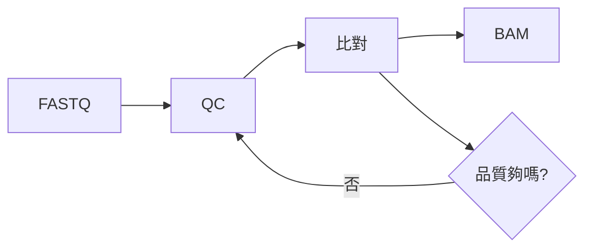

[Productivity](../README.md) › [文件](README.md) › Markdown

# Markdown

Markdown 用純文字標記寫出有格式的文件：README、筆記、GitHub issue / PR、Jupyter 與 R Markdown 的文字區塊都用它。本 notebook 以 GitHub Flavored Markdown (GFM) 撰寫，本篇是語法速查與本 notebook 的慣例。

## 基本語法

| 效果 | 語法 |
| --- | --- |
| 標題 | `# H1`、`## H2`、`### H3`（`#` 後要空格） |
| 粗體 / 斜體 / 刪除線 | `**粗體**`、`*斜體*`、`~~刪除~~` |
| 行內程式碼 | `` `code` `` |
| 連結、圖片 | 見下方區塊 |
| 清單 | `- 項目`；編號 `1. 項目`；縮排 2–4 格成為子清單 |
| 待辦清單 | `- [ ] 未完成`、`- [x] 已完成` |
| 引用 | `> 文字` |
| 分隔線 | `---` |
| 換行 | 段落之間空一行；行尾兩個空格或 `<br>` 強制換行 |
| 跳脫 | `\*`、`\|`、`\#` |
| 註腳 | `文字[^1]`，文末 `[^1]: 說明` |

```markdown
[外部連結](https://github.com)
[同 repo 的筆記](../spreadsheets/excel.md)        相對路徑，搬檔後要更新
[連到某個標題](../spreadsheets/excel.md#核心名詞)  anchor 規則見本篇最後
                        圖片
```

## 程式碼區塊

````markdown
```python
import pandas as pd
```
````

語言標記決定語法上色：`python`、`r`、`bash`、`powershell`、`sql`、`yaml`、`json`、`dockerfile`、`text`。要在區塊內顯示三個反引號時，外層改用四個。

## 表格

```markdown
| 欄位 | 說明 | 數值 |
| :--- | :---: | ---: |
| 靠左 | 置中 | 靠右 |
```

| 注意 | 說明 |
| --- | --- |
| 儲存格內的 `|` | 寫成 `\|`，包在 inline code 內也要跳脫 |
| 換行 | 儲存格內不能直接換行，用 `<br>` |
| 對齊 | 第二列的冒號位置決定靠左 / 置中 / 靠右 |
| 大表格 | 用編輯器擴充套件或從試算表複製後轉換 |

## GitHub 擴充

| 功能 | 語法 |
| --- | --- |
| 數學式 | 行內 `$E = mc^2$`；區塊 `$$ ... $$` |
| 提示框 (alerts) | `> [!NOTE]`、`> [!TIP]`、`> [!WARNING]` 開頭的引用區塊 |
| 摺疊區塊 | `<details><summary>標題</summary> 內容 </details>` |
| 自動連結 | 貼上 URL、`#123`（issue）、`@user`（會通知對方） |
| Mermaid 圖 | 語言標記為 `mermaid` 的程式碼區塊 |

### Mermaid

GitHub、VS Code 預覽、Obsidian 都能直接把 Mermaid 程式碼畫成圖。

````markdown

````

| 圖類型 | 開頭 | 用途 |
| --- | --- | --- |
| 流程圖 | `flowchart LR` / `TD` | 流程、決策 |
| 序列圖 | `sequenceDiagram` | API 呼叫、client / server 互動 |
| 甘特圖 | `gantt` | 時程 |
| Git 圖 | `gitGraph` | 分支與合併 |
| ER 圖 | `erDiagram` | 資料表關聯 |

> 純文字環境（終端機、不支援 Mermaid 的平台）看不到圖；簡單流程用 ASCII 箭頭（`A → B → C`）更通用，本 notebook 以 ASCII 為主。

## 預覽與編輯

| 工具 | 用法 |
| --- | --- |
| VS Code | `Ctrl + Shift + V` 開預覽；`Ctrl + K V` 並排預覽；內建支援 GFM，Mermaid 需裝擴充套件（見 [編輯器](../../computing/developer-tools/vscode.md)） |
| 線上編輯器 | [Markdown Editor](https://jbt.github.io/markdown-editor/) 等，不需安裝 |
| 轉成其他格式 | [Pandoc](https://pandoc.org/)：`pandoc note.md -o note.docx` / `.pdf` / `.html` |

## 本 notebook 的慣例

| 慣例 | 做法 |
| --- | --- |
| 麵包屑 | 每篇第一行，最多兩層上層 README + 本篇：`[Productivity](../README.md) › [文件](README.md) › Markdown` |
| 標題 | `# 中文標題 (English Title)`；專有名詞直接用英文 |
| 表格優先 | 定義、比較、指令速查都做成表 |
| 圖片與附檔 | 放在模組的 `src/`，相對路徑引用 |
| 交叉連結 | 已在其他筆記說明的概念直接連過去，不重寫 |
| 程式碼 | 標語言；同主題合併成一個區塊，用註解分段 |
| 連結檢查 | `uv run --no-project .claude/skills/rewrite-notes/check_links.py <資料夾>` |

### 標題 anchor 規則

GitHub 由標題自動產生 anchor：轉小寫、移除標點（含全形「：（）、」）、空白換成 `-`，中文保留。

| 標題 | Anchor |
| --- | --- |
| `## Getting Started` | `#getting-started` |
| `## 四分位距與離群值 (IQR & Outliers)` | `#四分位距與離群值-iqr--outliers` |
| `## 3. 假設分析 (What-If Analysis)` | `#3-假設分析-what-if-analysis` |

> 改標題會讓別篇連到這個 anchor 的連結失效；改完跑一次連結檢查。
