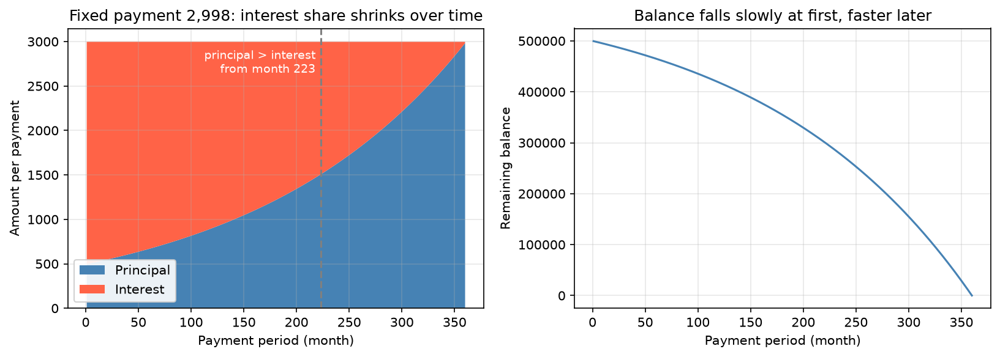

[Productivity](../README.md) › [試算表](README.md) › 貸款攤還表

# 貸款攤還表 (Loan Amortization)

攤還表列出固定期限貸款每一期的付款如何拆成利息與本金，以及剩餘本金怎麼降到零。適用房貸、車貸、學貸等固定期數的貸款；信用卡、循環額度這類餘額與付款都會變動的產品不適用。貨幣時間價值、NPV / IRR 等背後的概念見 [金融基本概念](../../data-science/applied-domains/finance/financial-concepts.md)。

## 表格欄位

| 欄位 | 意義 | 公式（第 k 期） |
| --- | --- | --- |
| 期數 (period) | 第幾期或付款日 | `k` |
| 期初餘額 | 本期付款前的未償本金 | 上期期末餘額 |
| 付款 (payment) | 每期固定付款 | `PMT` |
| 利息 (interest) | 期初餘額 × 每期利率 | `IPMT` |
| 本金 (principal) | 付款 − 利息 | `PPMT` |
| 期末餘額 | 期初餘額 − 本金 | — |

## Excel 函數

| 函數 | 語法 | 回傳 |
| --- | --- | --- |
| `PMT` | `PMT(rate, nper, pv, [fv], [type])` | 每期付款 |
| `IPMT` | `IPMT(rate, per, nper, pv, [fv], [type])` | 第 `per` 期的利息 |
| `PPMT` | `PPMT(rate, per, nper, pv, [fv], [type])` | 第 `per` 期的本金 |
| `CUMIPMT` / `CUMPRINC` | `CUMIPMT(rate, nper, pv, start, end, type)` | 某段期間累計利息 / 本金 |

| 參數 | 注意 |
| --- | --- |
| `rate` | **每期**利率：年利率 6%、按月付款 → `6%/12` |
| `nper` | 總期數：30 年按月 → `30*12` |
| `pv` | 貸款金額；結果為負數（現金流出），習慣上在前面加負號 |
| `type` | `0` = 期末付款（預設），`1` = 期初付款 |

> 最常見的錯誤是 `rate` 與 `nper` 沒有對齊付款頻率：把年利率直接當月利率，或期數用年數。

## 範例：50 萬、年利率 6%、30 年、按月付款

輸入放在 `B1:B3`（貸款金額 500000、年利率 6%、年數 30），表格從第 6 列開始，`A` 欄是期數 1–360：

| 欄 | 標題 | 第 6 列公式 | 第 1 期結果 |
| --- | --- | --- | --- |
| A | 期數 | `1`（往下填滿到 360） | 1 |
| B | 期初餘額 | `=$B$1`；第 7 列起 `=F6` | 500,000.00 |
| C | 付款 | `=-PMT($B$2/12, $B$3*12, $B$1)` | 2,997.75 |
| D | 利息 | `=-IPMT($B$2/12, A6, $B$3*12, $B$1)` | 2,500.00 |
| E | 本金 | `=-PPMT($B$2/12, A6, $B$3*12, $B$1)` | 497.75 |
| F | 期末餘額 | `=B6-E6` | 499,502.25 |

| 檢查 | 值 |
| --- | --- |
| 第 360 期期末餘額 | 0（四捨五入誤差內） |
| 總付款 | 2,997.75 × 360 ≈ 1,079,191 |
| 總利息 | ≈ 579,191（超過本金的 1.1 倍） |
| 15 年後剩餘本金 | ≈ 355,244：付了一半期數，本金只還了 29% |



每期付款固定，但組成隨時間改變：第 1 期 83% 是利息，要到第 223 期本金才超過利息。剩餘本金因此前期下降慢、後期下降快。

## 同樣的計算：Python

```python
import numpy as np
import numpy_financial as npf          # pip install numpy-financial

rate, n, pv = 0.06 / 12, 30 * 12, 500_000
per = np.arange(1, n + 1)
pmt = -npf.pmt(rate, n, pv)            # 2997.75
interest = -npf.ipmt(rate, per, n, pv) # 第 1 期 2500.00
principal = -npf.ppmt(rate, per, n, pv)  # 第 1 期 497.75
balance = pv - principal.cumsum()      # 第 180 期後 355244.22
```

## 情境分析

| 想知道 | 做法 |
| --- | --- |
| 利率 / 年限不同時月付多少 | [運算列表 (Data Table)](excel-data-analysis-workflow.md#3-假設分析-what-if-analysis)：列放利率、欄放年限 |
| 月付上限下能借多少 | `PV(rate, nper, -payment)` 或 [目標搜尋](excel-data-analysis-workflow.md#3-假設分析-what-if-analysis) |
| 提前還款的效果 | 加一欄「額外還款」，期末餘額 = 期初餘額 − 本金 − 額外還款；此時不能再用 `PPMT`，本金改成 `付款 − 利息` 逐列計算 |
| 輸入防呆 | 利率、年限用 [資料驗證](excel-data-validation.md) 限制範圍 |
